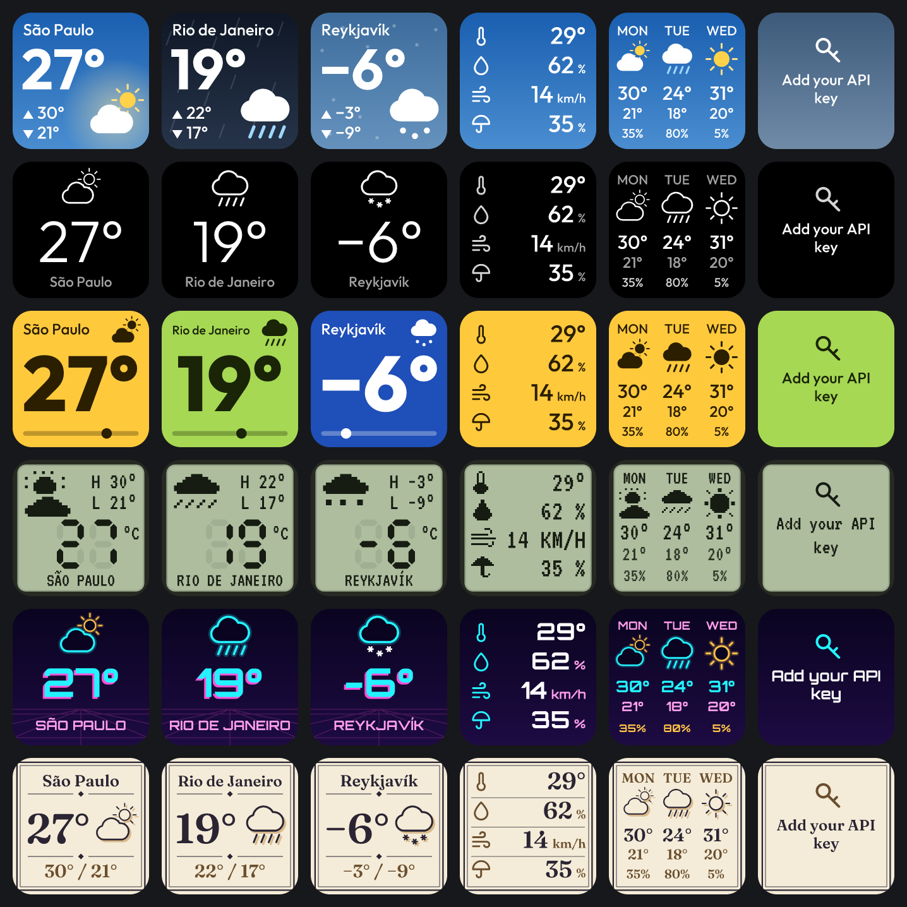
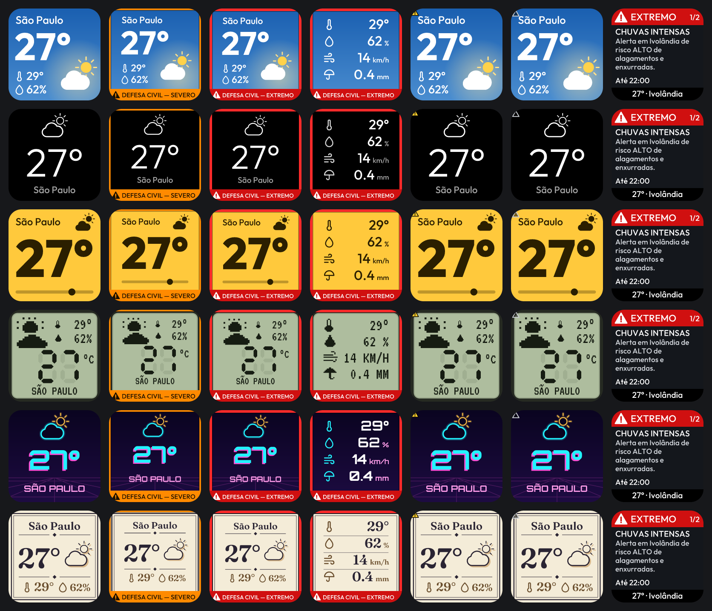

# Clima Pro

Live weather on your Ulanzi deck, in the theme you choose. A plugin for [Ulanzi Studio](https://www.ulanzi.com/pages/ulanzi-app), for the keys of the D200, D200H and D200X.

**Status:** not released yet. It has run in the real Ulanzi Studio with a valid key, but the full checklist in [docs/VERIFY.md](docs/VERIFY.md) has not been completed.

- **Six themes:** Sky, Minimal, Thermal, LCD, Neon and Almanac. Each key can have its own.
- **The latest conditions:** the plugin checks about a minute after WeatherAPI.com's next update is due, so there is no refresh setting to choose.
- **Two screens:** now and details (feels like, humidity, wind, precipitation). Press the key to switch.
- **Light on your machine:** almost no CPU use between updates, and no calls while the key is not on screen.
- **Your own free key:** the plugin uses your WeatherAPI.com account, and your key and location go only to WeatherAPI.com.
- **Defesa Civil alerts in Brazil:** official alerts appear over the forecast, which always stays on screen. See [below](#defesa-civil-alerts).

## Setup

1. Install Clima Pro from the Ulanzi Studio marketplace, or download `com.ulanzi.climapro.ulanziPlugin.zip` from [Releases](https://github.com/Weslley08/ulanzi-deck-clima-pro/releases) and unzip it into the plugins folder. The **Source code** archives on that page do not include the dependencies, so the plugin will not start from them.
   - Windows: `%APPDATA%\Ulanzi\UlanziDeck\Plugins\`
   - macOS: `~/Library/Application Support/Ulanzi/UlanziDeck/Plugins/`

   Then restart Studio.
2. Create a free key at [weatherapi.com](https://www.weatherapi.com/signup). Keep it private: it is tied to your account.
3. Drag **Weather** onto a key and paste your key into the settings panel. You only do this once.
4. Type a place and choose it from the list, or leave it empty to detect it from your IP. Pick a theme. The panel shows the place it found with its state, because different places can share a name.

WeatherAPI.com may not know your neighbourhood, and a neighbourhood's name can match a town somewhere else. If so, choose your city.

The panel and the messages on the key are available in English, Portuguese, Spanish and German. Keys draw the Latin alphabet only, so other scripts in a place name are left out. To put your own name on a key, use the title field in Ulanzi Studio.

## What the key shows

| On the key | Meaning | What to do |
|---|---|---|
| Add your API key | No key saved | Paste your key in the settings panel |
| Check your API key | WeatherAPI.com rejected it | Copy it again from your account |
| Location not found | No place matches | Try a nearby city, or a postcode |
| API limit reached | The key used up its monthly calls | Wait for the next month, or show fewer places |
| No connection | WeatherAPI.com cannot be reached | It retries by itself |
| Small dot in the corner | The last update failed, so the data is getting old | It retries by itself |

## Defesa Civil alerts

For a place in Brazil, the key also shows official alerts from the Defesa Civil's public feed (IDAP), using the place you already chose. There is nothing else to set up. **This does not replace official channels:** some alerts sent to phones may not be in the feed, and a key with no alert does not mean there is no danger.

For a place anywhere else, the feature turns itself off, because the feed only covers Brazil. Nothing is downloaded and the key looks as usual. The settings panel greys out the option and says why, with the country it found, in case the place was read as somewhere you did not mean. The option comes back as you left it when you choose a place in Brazil.

| On the key | Meaning |
|---|---|
| Nothing new | No alert in the feed reaches this place |
| Small yellow sign in the corner | A moderate or lower alert. Press to read it |
| Orange frame, `DEFESA CIVIL — SEVERO` | A severe alert. The forecast shrinks a little to make room, and nothing is covered |
| Red frame with a slow glow, `DEFESA CIVIL — EXTREMO` | An extreme alert |
| Small hollow sign in the corner | The alerts could not be checked recently. **This does not mean there are none** |

While an alert is active, a press opens it, the next press goes through any others, and the one after that moves on to the next forecast screen. An alert page goes back to the forecast by itself after 30 seconds, and it is never saved, so the key always starts on the forecast. The settings panel has the full text of each alert, with its instructions and who issued it.

**Data use:** the server offers no smaller download, so a key on screen fetches the whole feed every 5 minutes. That was 3 to 7 MB when measured on a quiet day, which comes to 35 to 85 MB an hour, and it grows when there are many alerts. Keys share one download, and nothing is fetched while no key is on screen or for places outside Brazil. If that is too much for your connection, set **Defesa Civil alerts** to **Off** in the panel for each key. Nothing about you or your place is sent: the feed covers all of Brazil, and matching happens on your machine.

Where the data comes from, what was checked and the limits of its coverage are in [docs/DEFESA-CIVIL.md](docs/DEFESA-CIVIL.md).

## How much of your quota it uses

Keys showing the same place share one request, and nothing is requested while no key is on screen. WeatherAPI.com says current conditions update every 10 to 15 minutes, so the plugin asks about a minute after the next update is due, and again every 3 minutes if it has not arrived yet. Kept on screen around the clock, one place should use about 3,000 to 6,000 calls a month. WeatherAPI.com's free plan listed 100,000 calls a month when this was written.

## Weather data

Weather data by [WeatherAPI.com](https://www.weatherapi.com/).

Weather information displayed here is provided for general informational purposes only. Forecasts and conditions are probabilistic and may not be accurate for your specific location or time. This data should not be used as the sole basis for decisions involving personal safety, aviation, marine navigation, emergency planning, or other safety-critical activities. Always consult official meteorological services and relevant authorities for decisions where accuracy is critical.

Your use of a WeatherAPI.com key is subject to [their terms](https://www.weatherapi.com/terms). This project is not affiliated with Ulanzi, WeatherAPI.com or the Defesa Civil.

## Contributing

You do not need a device, and adding a theme takes one file. See [CONTRIBUTING.md](CONTRIBUTING.md). Report security problems as described in [SECURITY.md](SECURITY.md).

## License

[Apache-2.0](LICENSE). Bundled components are listed in [THIRD_PARTY_NOTICES.md](com.ulanzi.climapro.ulanziPlugin/THIRD_PARTY_NOTICES.md).
